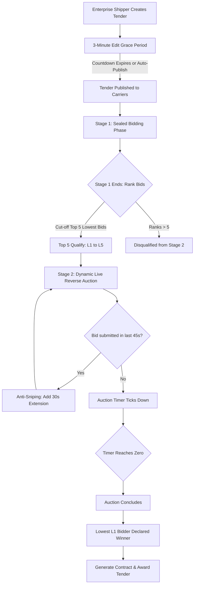
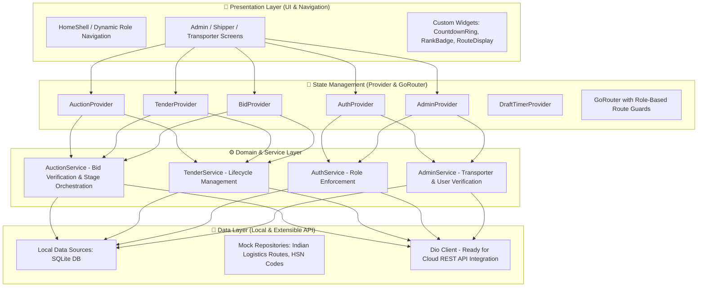

<div align="center">

# 🚛 LogiQ

### **Intelligent Reverse Auction & Freight Procurement Platform**

*Streamlining freight logistics with automated, transparent, multi-stage reverse bidding.*

---

[](https://flutter.dev)
[](https://dart.dev)
[](https://sqlite.org)
[](https://flutter.dev/multi-platform)
[](LICENSE)

[Explore Features](#-key-features) •
[System Architecture](#-system-architecture) •
[Reverse Auction Engine](#-two-stage-reverse-auction-engine) •
[Demo Credentials](#-demo-accounts--credentials) •
[Quick Start](#-quick-start-guide)

---

</div>

## 📌 Executive Overview

In conventional freight procurement, enterprise shippers spend days negotiating freight contracts over phone calls, spreadsheets, and fragmented messaging channels. This process is prone to cartel formation, opaque freight margins, delayed freight allocation, and suboptimal carrier discovery.

**LogiQ** is an enterprise-grade **Reverse Auction & Freight Procurement Platform** built with **Flutter** and an offline-first **SQLite** engine. It empowers shippers to publish detailed material tenders, invite certified transporters, and run automated, high-velocity two-stage reverse auctions where carriers compete transparently in real time to offer the most competitive freight quotes.

---

## ✨ Key Features

### 🏢 1. Shipper / Enterprise Portal
- **Tender Creation Suite**: Define multi-stop haulage routes (Pickup & Drop Hubs, City, Pincode), dispatch windows, delivery deadlines, and specific vehicle types (Open/Closed Body Truck, Flatbed Trailer, 20ft/40ft Container, ODC).
- **Cargo & Material Itemization**: Add itemized freight lots with description, HSN codes, quantity, unit of measure (`MT`, `Tons`, `Kg`, `Quintal`, `Bags`), and packaging remarks.
- **Bidding Rule Governance**: Set ceiling bids, reserve prices, minimum bid decrement steps (e.g., ₹500), and unit rate differentials (e.g., ₹25/unit).
- **3-Minute Grace Period / Auto-Publish**: Live countdown timer allowing shippers to revise, pause, or recall drafts before tenders are irrevocably locked and published to transporter feeds.
- **Direct Carrier Invitation**: Select from verified carrier directories or broadcast tenders across regional transporter pools.

### 🚚 2. Transporter / Carrier Portal
- **Tender Marketplace**: Filter active and upcoming tenders by route origin, destination, vehicle eligibility, and closing dates.
- **Stage 1 (Sealed Initial Bids)**: Transporters submit initial ceiling-compliant quotations.
- **Top 5 Qualification**: Automated cut-off filters and qualifies the Top 5 lowest bidders (`L1` to `L5`) for the live finale.
- **Stage 2 Live Reverse Auction Console**:
  - Live ranking indicator (`L1 Leader`, `L2`, `L3`...) updated with every bid.
  - Price-to-beat delta indicators showing exact gap to lowest market bid.
  - Quick-decrement bid buttons enforcing minimum reduction steps.
  - Dynamic overtime extensions (anti-sniping safeguard).
  - Winner celebration with interactive celebratory particle confetti and instant contract summary.

### 🛡️ 3. Admin & Compliance Officer Portal
- **Carrier Verification Workflows**: Inspect transporters' corporate legal profiles, **GSTIN**, and **Vahan Transport ID**. Approve or reject with detailed audit reason logs.
- **Platform Governance**: Real-time supervision of active tenders, running auctions, and bid frequency metrics.
- **Audit Trails**: Full transparency over user creation, approval histories, and contract awards.

---

## ⚡ Two-Stage Reverse Auction Engine

LogiQ utilizes a proven, collusion-resistant reverse bidding mechanism:



### ⏱️ Dynamic Anti-Sniping (Soft End Extension)
- **Problem**: In online auctions, competitors often wait until the last 3 seconds to place a bid, preventing genuine market price discovery.
- **LogiQ Solution**: If any carrier places a valid lower bid within the final **45 seconds** (`extensionWindow`), the timer automatically extends by **30 seconds** (`extensionAmount`), giving existing bidders opportunity to react up to a configured hard-stop threshold.

---

## 🏗️ System Architecture

LogiQ is designed following clean architecture principles, separating presentation, business logic providers, domain models, and unified data persistence:



---

## 🔑 Demo Accounts & Credentials

The application is pre-seeded with comprehensive demo data. You can test each role immediately using the credentials below:

| Role | Name | Company / Organization | Email | Password | Primary Actions |
|:---|:---|:---|:---|:---|:---|
| **Shipper / User** | Vikram Mehta | Reliance Freight Hub | `shipper@logiq.demo` | `Shipper@123` | Create tenders, configure routes, monitor live reverse auctions |
| **Shipper (Alt)** | Rahul Sharma | Tata Steel Enterprises | `user@logiq.com` | `123456` | Create drafts, view awarded contracts |
| **Transporter (L1)** | Transporter 1 | SpeedJet Logistics | `transporter@logiq.demo` | `Transporter@123` | Enter Stage 1 sealed bids, bid live in Stage 2, compete for L1 |
| **Admin** | Anil Verma | LogiQ Administration | `admin@logiq.demo` | `Admin@123` | Transporter GSTIN verification, approve user accounts, audit |

---

## 📂 Repository File Structure

```
LogiQ/
├── README.md                   # Primary project documentation
└── logiq/                      # Flutter core application root
    ├── pubspec.yaml            # Dependencies & Flutter configuration
    ├── analysis_options.yaml   # Linter and code quality rules
    └── lib/
        ├── main.dart           # App entry point, DB init & MultiProvider setup
        ├── app.dart            # MaterialApp configuration & theme bindings
        ├── core/
        │   ├── constants/      # App constants, business rules & demo timelines
        │   ├── database/       # SQLite helper, FFI factory, tables & seed data
        │   ├── router/         # GoRouter setup, custom transitions & auth guards
        │   ├── theme/          # Stitch design tokens (Navy, Electric Blue, Emerald)
        │   ├── utils/          # Currency formatters (INR), validators & haptics
        │   └── widgets/        # Reusable UI components (Timer, RankBadge, Cards)
        ├── data/
        │   ├── local/          # SQLite DAO data sources (Tender, Bid, Auction, User)
        │   └── mock/           # Pre-seeded users, transporters, HSN codes & tenders
        ├── models/             # Domain entities (Tender, Bid, Auction, User, Material)
        ├── providers/          # Reactive ChangeNotifier state controllers
        ├── screens/
        │   ├── admin/          # Admin approvals, transporter audit & user management
        │   ├── auth/           # Login screen & authentication state
        │   ├── profile/        # User profile & account overview
        │   ├── shell/          # Adaptive navigation shell
        │   ├── splash/         # Animated startup splash screen
        │   ├── transporter/    # Bidding console, live Stage 2 screen & my bids
        │   └── user/           # Shipper tender creation, drafts, active bids
        └── services/           # Business logic services for auctions and tenders
```

---

## 🛠️ Technology Stack

| Layer | Technology | Purpose |
|:---|:---|:---|
| **Framework** | [Flutter 3.x](https://flutter.dev) | Cross-platform UI development for Mobile, Web, and Desktop |
| **Language** | [Dart 3.x](https://dart.dev) | Modern, type-safe, null-safe compiled programming language |
| **State Management** | [Provider](https://pub.dev/packages/provider) | Decoupled reactive state management and dependency injection |
| **Local Database** | [sqflite](https://pub.dev/packages/sqflite) + [ffi](https://pub.dev/packages/sqflite_common_ffi) | High-performance, offline-first SQLite database supporting desktop/web |
| **Navigation** | [go_router](https://pub.dev/packages/go_router) | Declarative URL routing with custom transitions and role-based redirects |
| **UI & Animations** | [flutter_animate](https://pub.dev/packages/flutter_animate) | Fluid entrance, stagger, and micro-interaction animations |
| **Effects** | [confetti](https://pub.dev/packages/confetti) | Dynamic celebratory particle effects upon winning contract bids |
| **Networking** | [Dio](https://pub.dev/packages/dio) | Prepared for seamless plug-and-play REST API integration |
| **Localization & Time** | [intl](https://pub.dev/packages/intl) | Indian Rupee (`₹`) currency formatting and timestamp parsing |

---

## 🚀 Quick Start Guide

### Prerequisites
- [Flutter SDK](https://docs.flutter.dev/get-started/install) (`>= 3.11.1` recommended)
- Dart SDK (`>= 3.11.1`)
- Git

### Installation Steps

1. **Clone the repository**:
   ```bash
   git clone https://github.com/Pushpendra-7-ux/LogiQ.git
   cd LogiQ/logiq
   ```

2. **Install dependencies**:
   ```bash
   flutter pub get
   ```

3. **Run the application**:
   - **Chrome (Web)**:
     ```bash
     flutter run -d chrome
     ```
   - **macOS (Desktop)**:
     ```bash
     flutter run -d macos
     ```
   - **Android / iOS**:
     ```bash
     flutter run
     ```

4. **Login**:
   Select any pre-configured role from the [Demo Credentials](#-demo-accounts--credentials) table to explore the complete tender-to-auction lifecycle.

---

## 📊 Database Schema Highlights

The local SQLite database (`logiq_local.db`) maintains relational integrity across 9 dedicated tables:

```
┌──────────────┐       ┌──────────────────────┐       ┌────────────────────┐
│    users     │◀─────▶│     transporters     │       │     materials      │
└──────────────┘       └──────────────────────┘       └────────────────────┘
       ▲                          ▲                              ▲
       │                          │                              │ (1 to Many)
┌──────────────┐       ┌──────────────────────┐       ┌────────────────────┐
│   tenders    │──────▶│  tender_participants │       │      auctions      │
└──────────────┘       └──────────────────────┘       └────────────────────┘
       │                                                         ▲
       ▼                                                         │
┌──────────────┐       ┌──────────────────────┐       ┌────────────────────┐
│     bids     │──────▶│ auction_participants │◀─────▶│  auction_results   │
└──────────────┘       └──────────────────────┘       └────────────────────┘
```

- **`users`**: Role-based authentication (`user`, `transporter`, `admin`) and approval lifecycle states (`pending`, `approved`, `rejected`).
- **`transporters`**: Legal business identifiers (`gstin`, `vahan_transport_id`, verification status).
- **`tenders`**: Multi-leg route records, dispatch dates, price floor rules (`ceiling_bid`, `min_decrement`, `price_difference`).
- **`materials`**: Itemized cargo, weight/volume quantities, and official Indian HSN tariff classifications.
- **`auctions` & `bids`**: Atomic Stage 1 and Stage 2 bidding audit logs with microsecond timestamp validation.

---

## 🤝 Contributing

Contributions to elevate LogiQ are welcome! Follow these steps:

1. **Fork the Repository** on GitHub.
2. **Create a Feature Branch**:
   ```bash
   git checkout -b feature/dynamic-route-optimization
   ```
3. **Commit your changes**:
   ```bash
   git commit -m "feat: implement dynamic route calculation"
   ```
4. **Push to the branch**:
   ```bash
   git push origin feature/dynamic-route-optimization
   ```
5. **Open a Pull Request** with a detailed summary of your additions.

---

## 📄 License

This project is licensed under the **MIT License** — feel free to use, modify, and distribute it for enterprise and educational purposes.

---

<div align="center">
Developed with ❤️ by <a href="https://github.com/Pushpendra-7-ux"><strong>Pushpendra</strong></a>
<br>
<i>LogiQ — Revolutionizing Freight Logistics Through Intelligent Reverse Auctions.</i>
</div>